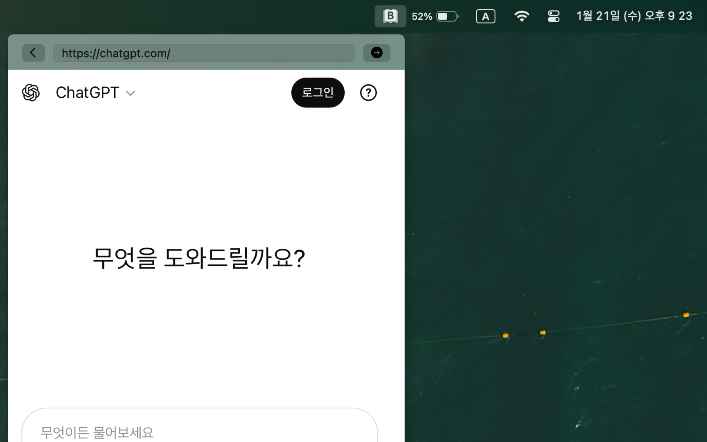
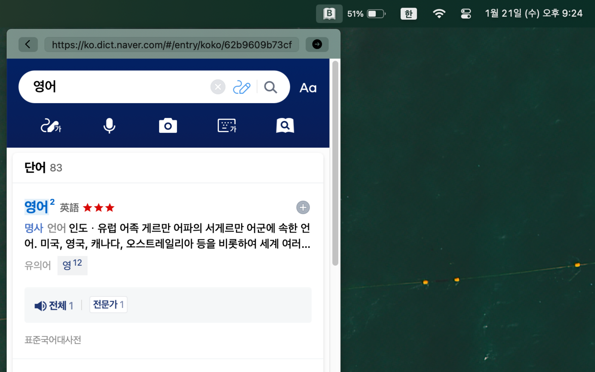
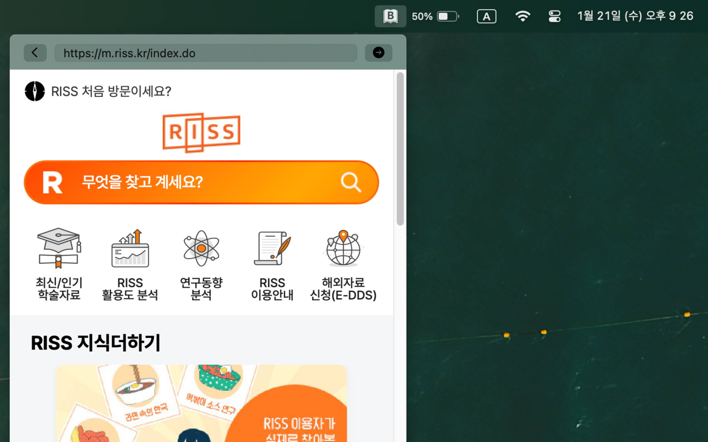

# Bar Browser (바브라우저)
맥os 상태바에 간단한 웹브라우저

## 프리뷰

  
  
  

## 앱 설명
메뉴바에서 바로 사용하는 새로운 웹 브라우저 경험
별도의 창 전환 없이, 필요한 순간에 바로 웹을 확인하세요.

이 앱은 메뉴바 영역에서 웹사이트를 볼 수 있는 미니 웹브라우저입니다.
클릭 한 번으로 사전, 성경, 검색 페이지를 빠르게 열 수 있습니다.

앱을 종료해도 걱정하지 마세요.
마지막에 보던 웹사이트를 자동으로 기억하여 시작 페이지로 다시 보여줍니다.

문서 작업 중 단어 뜻이 궁금할 때
논문이나 글을 쓰다 참고 자료가 필요할 때
코딩이나 편집 작업 중 간단한 검색이 필요할 때

모든 작업 흐름을 끊지 않고
메뉴바 안에서 빠르게 확인할 수 있습니다.

복잡한 기능은 과감히 제거했습니다.
정말 필요한 기능만 담은 심플한 미니 브라우저입니다.

가볍고 빠르게 동작하며
항상 손이 닿는 메뉴바에 조용히 머뭅니다.

웹서핑을 더 효율적으로,
작업은 더 집중할 수 있도록.

작지만 강력한 메뉴바 속 브라우저를 경험해보세요.

## 주요 기능
- **메뉴바 상주** — Dock 아이콘 없이 메뉴바에만 조용히 머무는 미니 브라우저
- **전역 단축키** — ⌃⌥⌘B로 어디서든 바로 열고 닫기 (설정에서 켜고 끌 수 있음)
- **창 크기 조절** — 가장자리를 드래그해 원하는 크기로 조절, 마지막 크기를 자동 저장/복원, 언제든 기본 크기로 초기화 가능
- **다크모드 지원** — 다크 / 라이트 / 시스템 설정 중에서 화면 모드 선택
- **백그라운드 재생 유지** — 팝오버를 닫아도(메뉴바 바깥 클릭) 유튜브 등에서 재생 중이던 오디오/영상이 끊기지 않음
- **로그인 시 자동 실행** — macOS 로그인과 동시에 앱 실행
- **마지막 페이지 복원** — 앱을 껐다 켜도 마지막에 보던 웹페이지를 그대로 이어서 표시
- **모바일 UA** — 좁은 팝오버 화면에 맞게 사이트를 모바일 레이아웃으로 표시

## 라이선스
바브라우저는 MIT 라이센스 하에 배포됩니다.
